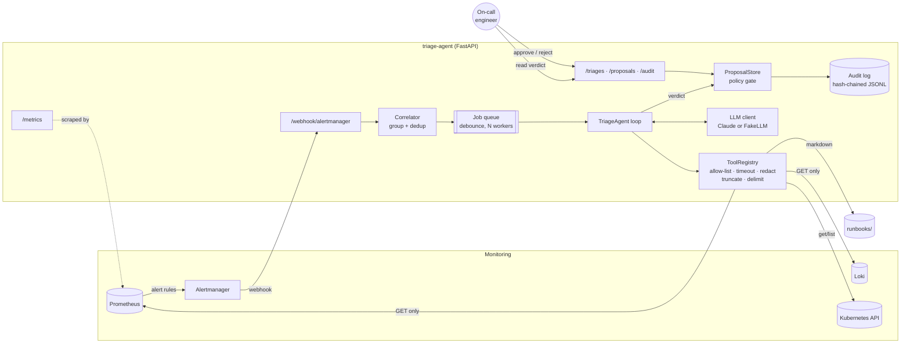
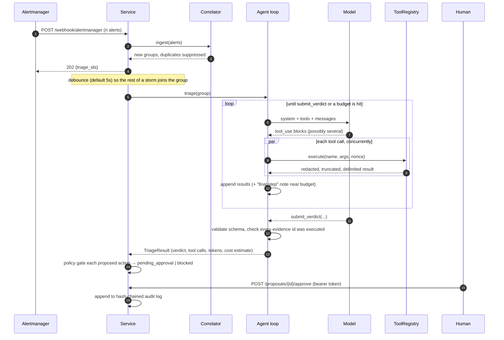

# Architecture

This document describes how the service is put together: components, data
flow, the agent loop, concurrency, observability and failure handling. The
reasoning behind the choices is in [DESIGN-DECISIONS.md](DESIGN-DECISIONS.md).

## Components



| Module | Responsibility |
|---|---|
| `app.py` | HTTP API, bearer-token checks, lifespan (starts and stops workers), `/metrics` mount |
| `service.py` | Orchestration: ingest → correlate → enqueue → run → register proposals → audit |
| `correlation.py` | Groups alerts by label key inside a sliding window; counts repeat notifications |
| `agent.py` | The tool-use loop, budgets, verdict validation, citation checks, fallback verdict |
| `prompts.py` | Static system prompt, per-run user prompt, `submit_verdict` tool schema |
| `llm/anthropic_client.py` | Claude via the official `anthropic` SDK |
| `llm/fake.py` | Deterministic scripted investigator for tests, CI and the offline demo |
| `tools/` | Read-only tools and the `ToolRegistry` that enforces guard-rails |
| `security.py` | Redaction, untrusted-data delimiting, injection heuristics, action policy |
| `approvals.py` | Proposals, approval decisions, tamper-evident audit log |
| `telemetry.py`, `metrics.py` | OpenTelemetry tracer setup; Prometheus metrics for the service itself |
| `scenarios.py` | Labelled scenario loader and fixture backends (evals, demo, tests) |

## A triage run, end to end



### Correlation

The correlation key defaults to `(alertname, namespace, workload)`. `workload`
is derived from the first of `deployment`, `statefulset`, `daemonset`,
`job_name`, `service` or `app`, or from the pod name by stripping the
ReplicaSet hash and pod suffix. Kubernetes generates those suffixes from a
vowel-free alphabet, so the regex matches only that alphabet; `node-exporter-x2x9k`
stays `node-exporter`.

Within the window (default 300 s, sliding on each new alert):

* an alert with a new key opens a group and queues one triage;
* an alert with a known key joins the group (a new pod in the same storm);
* an alert whose fingerprint is already in the group is counted as a duplicate;
* resolved alerts update status and never open groups.

### The agent loop

Each iteration:

1. Stop with `budget_exhausted` if the step limit or token budget is reached.
2. Call the model with the static system prompt, the tool list (sorted, so the
   prefix is stable) and the conversation so far.
3. Append the assistant turn verbatim (thinking blocks included).
4. `refusal` → stop. No tool calls → nudge once, then stop with `no_verdict`.
5. Run all non-verdict tool calls concurrently through the registry. Calls over
   the tool-call budget get an error result rather than running.
6. If `submit_verdict` was called, validate it with pydantic and check that
   every evidence item cites a tool call that actually ran. On failure, return
   the problem as an error result so the model can fix it; on success, stop.
7. If the next step is the last, or 85 % of the token budget is used, append a
   "final step: submit now" note to the tool results.

When the loop ends without a verdict, `fallback_verdict` produces an
`unknown`, zero-confidence verdict listing the evidence that was gathered. It
never guesses a cause.

After the loop the harness marks each evidence item `verified` and fills in
the query and link from the executed call, then re-redacts summaries.

### The tool registry

Every call passes through `ToolRegistry.execute`:

```
allow-list check → JSON-schema arg check → asyncio timeout → tool.run()
  → redact secrets → scan for injection → truncate (head + tail)
  → wrap in <tool_output nonce=... trust="untrusted"> → span + metrics
```

Exceptions from backends are reduced to their class name, so stack traces and
internal paths never reach the model.

| Tool | Backend | Limits |
|---|---|---|
| `prometheus_query` | `GET /api/v1/query` | 20 series |
| `prometheus_range_query` | `GET /api/v1/query_range` | ≤ 6 h, step ≥ 15 s, summarised per series |
| `loki_search` | `GET /loki/api/v1/query_range` | ≤ 6 h, ≤ 200 lines, 500 chars per line, selector required |
| `k8s_get_pods` / `k8s_describe_pod` / `k8s_get_events` / `k8s_rollout_history` | official client, `list_*` / `read_*` only | namespace allow-list, DNS-1123 name validation |
| `runbook_lookup` | `runbooks/*.md` | top 2 matches, 2,500 chars each |

A backend set to `None` (for example Kubernetes when `TRIAGE_KUBERNETES_MODE=off`)
removes its tools from the model's view entirely.

## Concurrency model

* One asyncio event loop (uvicorn). The webhook handler only correlates and
  enqueues, so it returns in milliseconds and Alertmanager never times out.
* `TRIAGE_MAX_CONCURRENT_TRIAGES` worker tasks consume the queue. Within a
  triage, tool calls from one model turn run concurrently.
* The Kubernetes client is synchronous; calls run in `asyncio.to_thread` with a
  per-request timeout, inside the registry's own timeout.
* State (runs, groups, proposals) is in memory, bounded to the last 500 runs.
  The audit log is the only durable state. Run a single replica (see
  limitations in the README).

## Observability

**Traces** (OpenTelemetry; exported over OTLP/HTTP when
`OTEL_EXPORTER_OTLP_ENDPOINT` is set):

| Span | Key attributes |
|---|---|
| `webhook.ingest` | `alerts.received`, `alerts.new_groups`, `alerts.duplicates` |
| `correlate` | |
| `triage.run` | `triage.id`, `triage.alertname`, `triage.outcome`, `triage.steps`, `triage.tool_calls`, `triage.cause_category`, `triage.confidence`, total tokens |
| `llm.call` | `gen_ai.request.model`, `gen_ai.response.finish_reason`, `gen_ai.usage.input_tokens`, `gen_ai.usage.output_tokens`, cache read/write tokens, `gen_ai.response.id` |
| `tool.<name>` | `tool.args` (truncated), `tool.status`, `tool.truncated`, `tool.redactions`, `tool.injection_flags`, `tool.output_chars` |

The Anthropic SDK emits its own spans under the active span when a tracer
provider is installed, so API spans nest under `llm.call`.

**Metrics** (`/metrics/`, Prometheus format): alerts received / grouped /
deduplicated, triage runs by outcome, triage duration and steps, tool calls by
tool and status, tool latency, injection flags by tool, LLM calls by stop
reason, LLM tokens by kind, LLM latency, proposals by status, approval
decisions.

## Failure handling

| Failure | Behaviour |
|---|---|
| Tool backend down or slow | Error result to the model (`ERROR: ConnectError`, `timed out after 10s`); the model can try another source |
| Model calls an unknown tool or bad args | Error result naming the problem; counts against the tool-call budget |
| Model cites a call it never made | Verdict rejected with the list of valid ids |
| Model never finishes | One nudge, then `no_verdict` fallback |
| Step or token budget hit | `budget_exhausted` fallback with the evidence gathered |
| Provider error after SDK retries | `error` fallback; the run is recorded, the worker keeps going |
| Refusal | `refused` fallback (server-side fallback models are requested where supported) |
| Worker exception | Logged, run marked failed, audit entry written, worker continues |

## Cost

Tokens are recorded per run (input, output, cache read, cache write) on each
`TriageResult`, on the `llm.call` spans and in `triage_llm_tokens_total`. To
estimate cost:

1. Run `make eval-live` at the model and effort you intend to use. The report
   has tokens per scenario.
2. Take current per-million-token prices for that model from your provider's
   pricing page (they differ by model, platform and contract; none are
   hard-coded here).
3. Cost per triage = `input × p_in + output × p_out + cache_read × p_cache_read
   + cache_write × p_cache_write`, divided by 10⁶. Set
   `TRIAGE_PRICE_*_PER_MTOK` and the service computes this per run
   (`estimated_cost_usd`).
4. Multiply by triages per day *after* correlation (not alerts per day) for a
   monthly figure.

Levers, roughly in order: correlation (fewer runs), prompt caching (stable
prefix, already set up), lower effort, a smaller step budget, then a cheaper
model, each checked with `make eval-live` before and after. FakeLLM token
counts are character-based estimates and are labelled as such.
